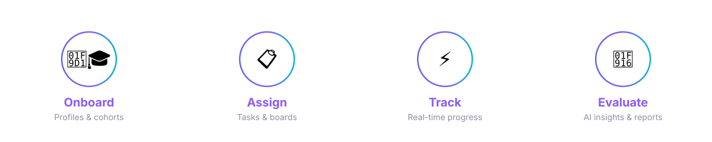
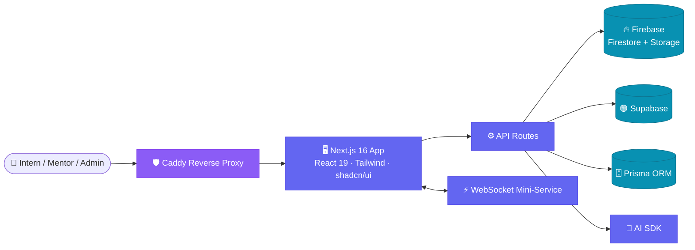

<div align="center">



<br/>

<a href="https://github.com/siddheshsalve77/Strides-Intern-Management-AI">
  
</a>

<br/><br/>


<br/>

**[Overview](#-overview) · [Workflow](#-how-it-works) · [Features](#-features) · [Architecture](#-architecture) · [Tech Stack](#-tech-stack) · [Get Started](#-getting-started) · [Roadmap](#-roadmap) · [Author](#-author)**


</div>

## 📖 Overview

**Strides Intern Management AI** is a modern web platform that runs an internship program end to end. Interns, mentors and admins share one workspace with task boards, live progress analytics and an AI assistant that takes over the repetitive parts of managing a cohort.

> 💡 **Why it exists:** spreadsheets and chat threads don't scale. Strides gives every intern a clear path and gives every manager a live picture of how the program is doing.


## 🔄 How It Works

<div align="center">
  
</div>


## ✨ Features

<table>
  <tr>
    <td width="50%" valign="top">
      <h3>🧑‍🎓 Intern Management</h3>
      Profiles, cohorts, roles and onboarding in a single workspace.
    </td>
    <td width="50%" valign="top">
      <h3>📋 Drag-and-Drop Boards</h3>
      Kanban-style task tracking powered by <code>dnd-kit</code>.
    </td>
  </tr>
  <tr>
    <td valign="top">
      <h3>🤖 AI Assistant</h3>
      Summaries, feedback and suggestions with clean Markdown-rendered responses.
    </td>
    <td valign="top">
      <h3>📊 Analytics Dashboards</h3>
      Progress, performance and workload charts built with Recharts.
    </td>
  </tr>
  <tr>
    <td valign="top">
      <h3>⚡ Real-Time Updates</h3>
      A WebSocket mini-service keeps every screen in sync.
    </td>
    <td valign="top">
      <h3>🔐 Secure Data Layer</h3>
      Firestore and Storage security rules, plus Supabase and Prisma integrations.
    </td>
  </tr>
  <tr>
    <td valign="top">
      <h3>🌍 Multi-Language Ready</h3>
      Internationalization through <code>next-intl</code>.
    </td>
    <td valign="top">
      <h3>🌗 Light / Dark Mode</h3>
      Smooth theming with <code>next-themes</code> and Framer Motion animations.
    </td>
  </tr>
</table>


## 🏗️ Architecture




## 🧰 Tech Stack

<div align="center">


</div>

| Layer | Technologies |
|---|---|
| **Frontend** | Next.js 16, React 19, TypeScript, Tailwind CSS 4, shadcn/ui, Radix UI, Framer Motion |
| **State & Forms** | Zustand, TanStack Query, TanStack Table, React Hook Form, Zod |
| **Backend & DB** | Firebase (Firestore, Admin SDK), Supabase, Prisma |
| **Realtime** | WebSocket mini-service |
| **AI** | `z-ai-web-dev-sdk`, `react-markdown` |
| **Visualization** | Recharts, Embla Carousel |
| **Tooling** | Bun, ESLint 9, Caddy |


## 🖼️ Screenshots

<!-- Replace with your real screenshots: save them in /public or /assets and link here -->
<div align="center">

| Dashboard | Task Board | AI Assistant |
|:---:|:---:|:---:|
| *add screenshot* | *add screenshot* | *add screenshot* |

</div>


## 📂 Project Structure

<details>
<summary><b>Click to expand</b></summary>

```bash
Strides-Intern-Management-AI/
├── src/              # Application source (pages, components, hooks, lib)
├── public/           # Static assets
├── assets/           # README animations
├── prisma/           # Prisma schema
├── db/               # Database files
├── mini-services/    # Standalone services (e.g. WebSocket server)
├── examples/         # Usage examples (WebSocket)
├── scripts/          # Helper scripts (db-push, etc.)
├── tests/            # Tests
├── firestore.rules   # Firestore security rules
├── storage.rules     # Firebase Storage security rules
├── Caddyfile         # Reverse proxy configuration
├── .env.example      # Environment variable template
└── package.json
```

</details>


## 🚀 Getting Started

### Prerequisites

- [Bun](https://bun.sh) (recommended) or Node.js 20+
- A Firebase project (and a Supabase project if you use it)

### Installation

```bash
# 1. Clone the repository
git clone https://github.com/siddheshsalve77/Strides-Intern-Management-AI.git
cd Strides-Intern-Management-AI

# 2. Install dependencies
bun install

# 3. Configure environment variables
cp .env.example .env      # then fill in your keys

# 4. Push the database schema
bun run db:push

# 5. Build and start
bun run build
bun run start
```

Open **http://localhost:3000** 🎉

<details>
<summary><b>📜 Available scripts</b></summary>

| Command | Description |
|---|---|
| `bun run build` | Production build (standalone output) |
| `bun run start` | Start the standalone server on port `3000` |
| `bun run dev` | Run the built standalone server |
| `bun run db:push` | Push the database schema |
| `bun run lint` | Lint the codebase with ESLint |

</details>

<details>
<summary><b>🔑 Environment variables</b></summary>

Copy `.env.example` to `.env` and provide values for Firebase, Supabase, the AI SDK and your database URL.

> ⚠️ Never commit `.env` or `firebase-service-account.json`. Keep both out of version control.

</details>


## 🗺️ Roadmap

- [x] Core intern & task management
- [x] Analytics dashboards
- [x] Real-time WebSocket updates
- [ ] Role-based access polish (Admin / Mentor / Intern)
- [ ] Automated weekly progress reports
- [ ] Email & in-app notifications
- [ ] Mobile-first PWA support

## 🤝 Contributing

Contributions are welcome!

1. Fork the repo
2. Create a branch: `git checkout -b feature/amazing-feature`
3. Commit: `git commit -m "Add amazing feature"`
4. Push: `git push origin feature/amazing-feature`
5. Open a Pull Request

## ⭐ Star History

<div align="center">
  <a href="https://star-history.com/#siddheshsalve77/Strides-Intern-Management-AI&Date">
    
  </a>
</div>


## 👩‍💻 Author

<div align="center">

**Vijayshree Sundge**

[](https://github.com/vijayshree-sundge)

<br/>

⭐ **If you found this project useful, please give it a star!** ⭐


</div>
