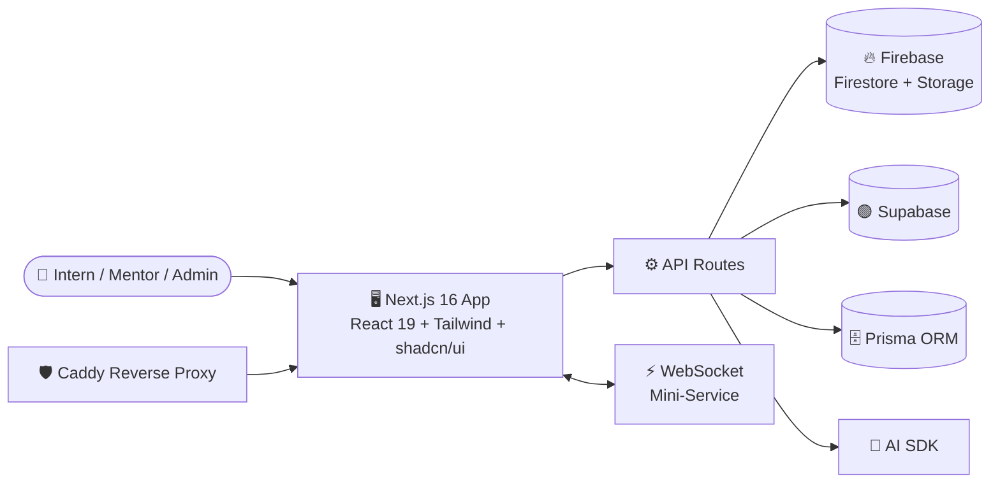

<div align="center">


<a href="https://git.io/typing-svg">
  
</a>

<br/>


</div>

---

## 📖 Overview

**Strides Intern Management AI** is a modern web platform that helps organizations run their internship programs end to end. It brings interns, mentors and admins into one place — with task boards, progress analytics, real-time updates and an AI assistant that removes the repetitive work of managing a cohort.

> 💡 **Why it exists:** spreadsheets and chat threads don't scale. Strides gives every intern a clear path and gives every manager a live picture of how the program is going.

---

## ✨ Features

| | Feature | What it does |
|---|---|---|
| 🧑‍🎓 | **Intern Management** | Profiles, cohorts, roles and onboarding in a single workspace |
| 📋 | **Drag-and-Drop Task Boards** | Kanban-style task tracking powered by `dnd-kit` |
| 🤖 | **AI Assistant** | Generates summaries, feedback and suggestions with Markdown-rendered responses |
| 📊 | **Analytics Dashboards** | Progress, performance and workload charts built with Recharts |
| ⚡ | **Real-Time Updates** | WebSocket mini-service keeps every screen in sync |
| 🔐 | **Secure Data Layer** | Firestore & Storage security rules, plus Supabase and Prisma integrations |
| 🌍 | **Multi-Language Ready** | Internationalization with `next-intl` |
| 🌗 | **Light / Dark Mode** | Smooth theming with `next-themes` and Framer Motion animations |

---

## 🏗️ Architecture



---

## 🧰 Tech Stack

<div align="center">

| Layer | Technologies |
|---|---|
| **Frontend** | Next.js 16, React 19, TypeScript, Tailwind CSS 4, shadcn/ui, Radix UI, Framer Motion |
| **State & Data** | Zustand, TanStack Query, TanStack Table, React Hook Form, Zod |
| **Backend & DB** | Firebase (Firestore, Admin SDK), Supabase, Prisma |
| **Realtime** | WebSocket mini-service |
| **AI** | `z-ai-web-dev-sdk`, `react-markdown` |
| **Visualization** | Recharts, Embla Carousel |
| **Tooling** | Bun, ESLint 9, Caddy |

</div>

---

## 📂 Project Structure

```bash
Strides-Intern-Management-AI/
├── src/              # Application source (pages, components, hooks, lib)
├── public/           # Static assets
├── prisma/           # Prisma schema
├── db/               # Database files
├── mini-services/    # Standalone services (e.g. WebSocket server)
├── examples/         # Usage examples (WebSocket)
├── scripts/          # Helper scripts (db-push, etc.)
├── tests/            # Tests
├── firestore.rules   # Firestore security rules
├── storage.rules     # Firebase Storage security rules
├── Caddyfile         # Reverse proxy configuration
├── .env.example      # Environment variable template
└── package.json
```

---

## 🚀 Getting Started

### Prerequisites

- [Bun](https://bun.sh) (recommended) or Node.js 20+
- A Firebase project (and Supabase project if you use it)

### Installation

```bash
# 1. Clone the repository
git clone https://github.com/siddheshsalve77/Strides-Intern-Management-AI.git
cd Strides-Intern-Management-AI

# 2. Install dependencies
bun install

# 3. Configure environment variables
cp .env.example .env
# then fill in your Firebase / Supabase / AI keys

# 4. Push the database schema
bun run db:push

# 5. Build the app
bun run build

# 6. Start the server
bun run start
```

Open **http://localhost:3000** 🎉

### Available Scripts

| Command | Description |
|---|---|
| `bun run build` | Production build (standalone output) |
| `bun run start` | Start the standalone server on port `3000` |
| `bun run dev` | Run the built standalone server |
| `bun run db:push` | Push the database schema |
| `bun run lint` | Lint the codebase with ESLint |

---

## 🔑 Environment Variables

Copy `.env.example` to `.env` and provide values for:

```env
# Firebase
# Supabase
# AI SDK key
# Database URL
```

> ⚠️ Never commit `.env` or `firebase-service-account.json`. Both are required locally but must stay out of version control.

---

## 🗺️ Roadmap

- [x] Core intern & task management
- [x] Analytics dashboards
- [x] Real-time WebSocket updates
- [ ] Role-based access polish (Admin / Mentor / Intern)
- [ ] Automated weekly progress reports
- [ ] Email & in-app notifications
- [ ] Mobile-first PWA support

---

## 🤝 Contributing

Contributions are welcome!

1. Fork the repo
2. Create a branch: `git checkout -b feature/amazing-feature`
3. Commit: `git commit -m "Add amazing feature"`
4. Push: `git push origin feature/amazing-feature`
5. Open a Pull Request

---

## 👨‍💻 Author

<div align="center">

**Siddhesh Salve (Hastar)**

[](https://github.com/siddheshsalve77)
[](https://siddhesh-salve-portfolio.vercel.app)

⭐ **If you found this project useful, please give it a star!** ⭐


</div>
